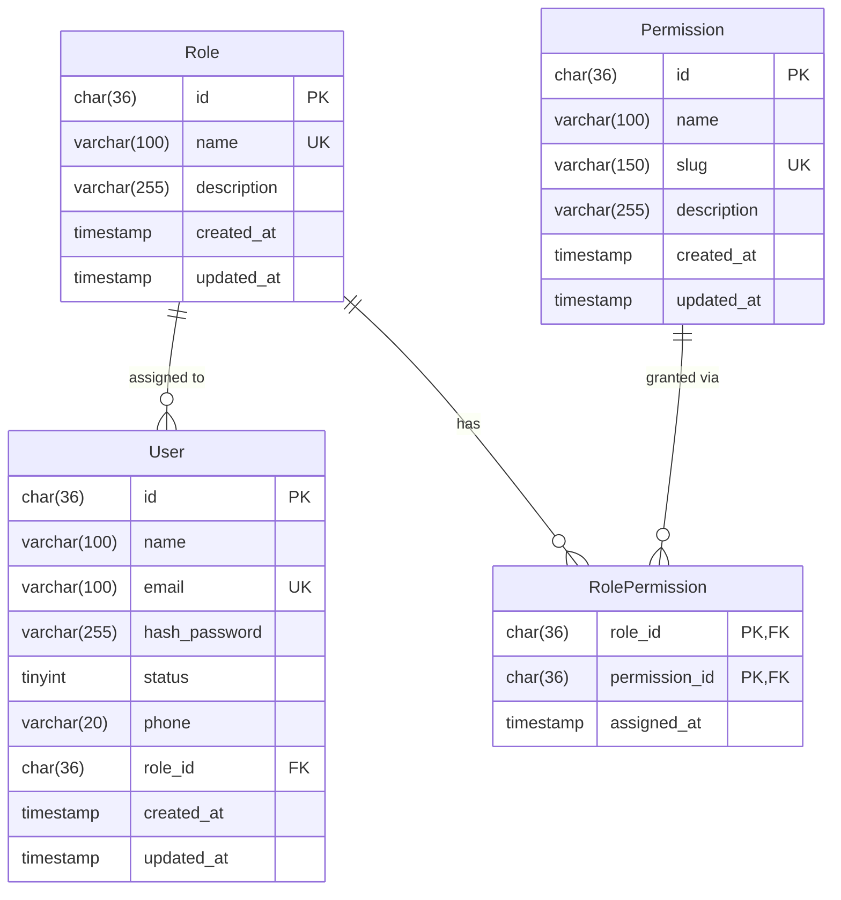

# User & RBAC Database Schema

Documentation for the User Management and Role-Based Access Control (RBAC) domain in **Hou_Express_API**.

## Schema Location (Prisma Multi-File Setup)

The models for this domain are modularized across the following schema files:

- `prisma/schema/models/user.prisma`
- `prisma/schema/models/role.prisma`
- `prisma/schema/models/permission.prisma`
- `prisma/schema/models/role-permission.prisma`

---

## Entity Relationship Diagram (ERD)

---

## Table Specifications

### 1. `users` (`User`)

Stores core user credentials, profile details, and role assignment.

| Prisma Field   | DB Column       | Type           | Constraints              | Description                                             |
| :------------- | :-------------- | :------------- | :----------------------- | :------------------------------------------------------ |
| `id`           | `id`            | `CHAR(36)`     | `PK`, `UUID`             | Unique user identifier.                                 |
| `name`         | `name`          | `VARCHAR(100)` | `NOT NULL`               | Full display name of the user.                          |
| `email`        | `email`         | `VARCHAR(100)` | `UNIQUE`, `NOT NULL`     | Login email address.                                    |
| `hashPassword` | `hash_password` | `VARCHAR(255)` | `NOT NULL`               | Bcrypt/Argon2 hashed password.                          |
| `status`       | `status`        | `TINYINT`      | `DEFAULT 1`              | Account state (`1` = Active, `0` = Inactive/Suspended). |
| `phone`        | `phone`         | `VARCHAR(20)`  | `NULLABLE`               | Contact phone number.                                   |
| `roleId`       | `role_id`       | `CHAR(36)`     | `FK`, `INDEX`            | References `roles.id`.                                  |
| `createdAt`    | `created_at`    | `TIMESTAMP(0)` | `DEFAULT now()`          | Record creation timestamp.                              |
| `updatedAt`    | `updated_at`    | `TIMESTAMP(0)` | `@updatedAt`, `NULLABLE` | Last modification timestamp.                            |

---

### 2. `roles` (`Role`)

Defines system roles (e.g., Super Admin, Staff, Customer).

| Prisma Field  | DB Column     | Type           | Constraints              | Description                             |
| :------------ | :------------ | :------------- | :----------------------- | :-------------------------------------- |
| `id`          | `id`          | `CHAR(36)`     | `PK`, `UUID`             | Unique role identifier.                 |
| `name`        | `name`        | `VARCHAR(100)` | `UNIQUE`, `NOT NULL`     | Role title (e.g., `admin`, `manager`).  |
| `description` | `description` | `VARCHAR(255)` | `NULLABLE`               | Summary of the role's responsibilities. |
| `createdAt`   | `created_at`  | `TIMESTAMP(0)` | `DEFAULT now()`          | Record creation timestamp.              |
| `updatedAt`   | `updated_at`  | `TIMESTAMP(0)` | `@updatedAt`, `NULLABLE` | Last modification timestamp.            |

---

### 3. `permissions` (`Permission`)

Defines granular system actions/capabilities.

| Prisma Field  | DB Column     | Type           | Constraints              | Description                                                            |
| :------------ | :------------ | :------------- | :----------------------- | :--------------------------------------------------------------------- |
| `id`          | `id`          | `CHAR(36)`     | `PK`, `UUID`             | Unique permission identifier.                                          |
| `name`        | `name`        | `VARCHAR(100)` | `NOT NULL`               | Human-readable permission name (e.g., `Create User`).                  |
| `slug`        | `slug`        | `VARCHAR(150)` | `UNIQUE`, `NOT NULL`     | Machine-readable key used in middleware/guards (e.g., `users.create`). |
| `description` | `description` | `VARCHAR(255)` | `NULLABLE`               | Details on what this permission grants.                                |
| `createdAt`   | `created_at`  | `TIMESTAMP(0)` | `DEFAULT now()`          | Record creation timestamp.                                             |
| `updatedAt`   | `updated_at`  | `TIMESTAMP(0)` | `@updatedAt`, `NULLABLE` | Last modification timestamp.                                           |

---

### 4. `role_permissions` (`RolePermission`)

Explicit many-to-many join table linking `roles` and `permissions`.

| Prisma Field   | DB Column       | Type           | Constraints         | Description                                    |
| :------------- | :-------------- | :------------- | :------------------ | :--------------------------------------------- |
| `roleId`       | `role_id`       | `CHAR(36)`     | `PK`, `FK`          | References `roles.id`.                         |
| `permissionId` | `permission_id` | `CHAR(36)`     | `PK`, `FK`, `INDEX` | References `permissions.id`.                   |
| `assignedAt`   | `assigned_at`   | `TIMESTAMP(0)` | `DEFAULT now()`     | Timestamp when permission was granted to role. |

---

## Referential Integrity & Rules

- **Role Deletion (`Restrict`):** A `Role` **cannot** be deleted if any `User` is currently assigned to it (`onDelete: Restrict`). Reassign users before deleting a role.
- **Role/Permission Deletion (`Cascade`):** Deleting a `Role` or a `Permission` automatically cleans up its associated records in `role_permissions` (`onDelete: Cascade`).
- **ID Updates (`Cascade`):** Updating a primary key `id` on `Role` or `Permission` cascades to foreign keys (`onUpdate: Cascade`).

---
